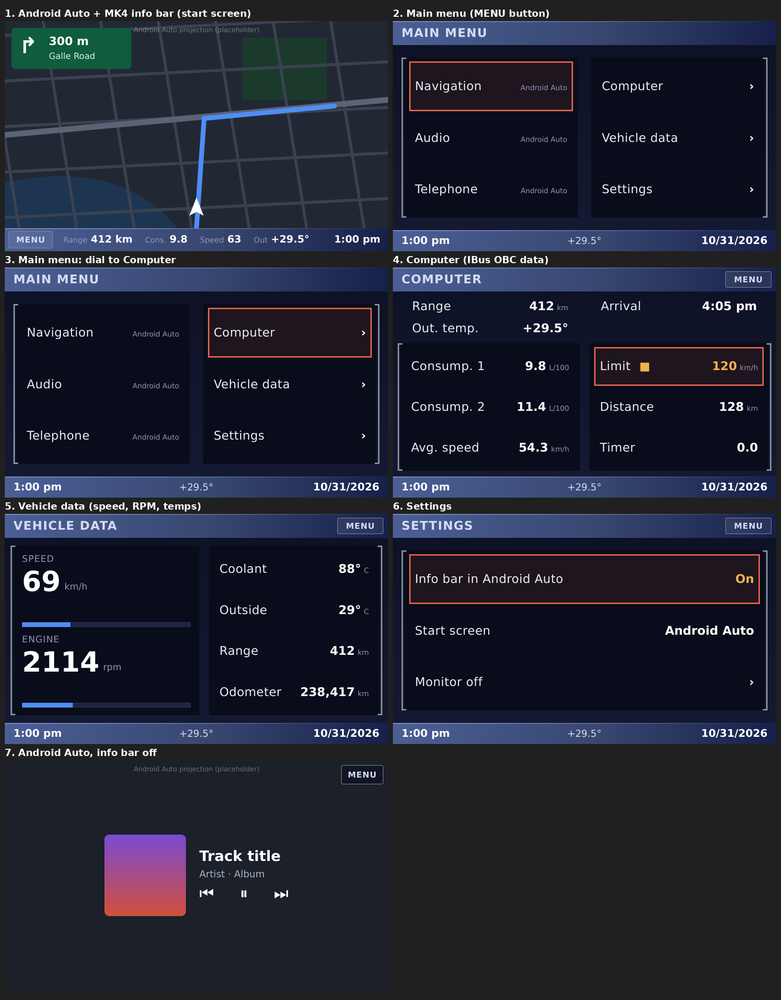

# MK4-navigation-style UI with IBus data (experiment)

Standalone QML prototype. It is **not** built into crankshaft-ui-slim and changes nothing in the app.
It has a BMW MK4-navigation (Board Monitor) look for 800x480, switches between Android Auto and a native menu,
and shows on-board computer and vehicle data from the car's IBus.
All data currently comes from `MockIbus.qml`.



## Run it

```sh
# on a PC or on the Pi (needs qml6-module-qtquick, qml6-module-qtquick-window)
qml experiments/mk4-ibus-ui/main.qml          # or: /usr/lib/qt6/bin/qml
# re-render the screenshots (PySide6):
QT_QPA_PLATFORM=offscreen python3 experiments/mk4-ibus-ui/render.py experiments/mk4-ibus-ui/screens
```

Keyboard keys stand in for the BMBT controls: ←/↑ and →/↓ turn the dial, Enter presses the dial, and Esc/M is the **MENU** button. Touch works everywhere.

## Screens and switching

| Screen | How you get there | Notes |
|---|---|---|
| Android Auto | Start screen; **Navigation / Audio / Telephone** in the main menu | Optional MK4 info bar at the bottom shows range, consumption, speed, outside temperature and time |
| Main menu | **MENU** from Android Auto | Pressing **MENU** again returns to Android Auto |
| Computer | Main menu › Computer | Layout follows the original *COMPUTER* page |
| Vehicle data | Main menu › Vehicle data | Live speed/RPM bars, temperatures, odometer |
| Settings | Main menu › Settings | Info bar on/off, start screen (Android Auto or main menu), monitor off |

## IBus mapping (from [wilhelm-docs](https://github.com/piersholt/wilhelm-docs))

Every `MockIbus` property maps to a documented message, so a real backend can expose the same property names and the screens stay as they are.

| Property | Message | Notes |
|---|---|---|
| `time` `date` `outsideTemp` `consumption1` `consumption2` `range` `distance` `arrival` `limit` `avgSpeed` `timer` | IKE `0x24` OBC Text (`80 .. E7/3B 24 <id> <flags> <ascii>`) | ids 01,02,03,04,05,06,07,08,09,0A,0E. The text arrives already formatted in the car's units. |
| `speedKmh` `rpm` | IKE `0x18` (`80 05 BF 18 <speed/2> <rpm/100>`) | speed in steps of 2 km/h, RPM in steps of 100 |
| `ambientC` `coolantC` | IKE `0x19` (`80 06 BF 19 <amb> <cool> <ext>`) | signed °C |
| `odometerKm` | IKE `0x17`, after a `0x16` request | 3 bytes, little-endian |
| units | IKE `0x15` Language & Region | km/miles, L/100/MPG/km/l, °C/°F, 12h/24h |
| `limitActive` `timerRunning` | IKE `0x2a` OBC status | |

**Actions** send GT→IKE `0x41` OBC Control (`3B 05 80 41 <id> <control> <xor>`). `MockIbus.obcControl()` logs the frame it would send:

| Selecting | Sends |
|---|---|
| Consump. 1 / Consump. 2 / Avg. speed | `04 10` / `05 10` / `0A 10`: recalculate (reset) |
| Limit | `09 04` activate / `09 08` deactivate (`09 20` = set to current speed) |
| Timer | `0E 04` start / `0E 08` stop |

**Controls**, BMBT (`0xF0`) → GT (`0x3B`):

| Control | Message | Here |
|---|---|---|
| Dial | `0x49`: bit 7 = direction, bits 0-4 = steps | `dial(±steps)` |
| Dial press | `0x48` BUTTON_CONFIRM (`0x05`) | `confirm()` |
| MENU | `0x48` BUTTON_MENU (`0x34`) | `menuButton()` |

While Android Auto is on screen, the dial and dial press should go to the phone as Android Auto rotary-controller input (`KEYCODE_ROTARY_CONTROLLER` / DPAD centre), so you can drive AA with the original knob. MENU always comes back to the native UI.

## Integration plan (later, in the main code base)

1. **core: `IbusService`.** It reads an IBus interface (for example a Resler/USB IBus adapter on `/dev/ttyUSB0`, 9600 baud 8E1), checks the XOR checksum, decodes the messages above and publishes them over the existing WebSocket as `ibus/obc/<property>`, `ibus/vehicle/*` and `ibus/bmbt/{dial,button}`. It also accepts `ibus/obc/control` and turns it into `0x41` frames. At ignition it sends `0x41 <id> 01` text requests to fill the cache, as the GT does.
2. **ui-slim: `IbusFacade`.** It exposes the same properties as `MockIbus.qml` and is fed from CoreClient.
3. **ui-slim shell.** Move these screens into `src/qml/mk4/` behind a "theme: MK4" setting. Keep the real `AAProjectionView` where the placeholder is now. When the info bar is on, size the AA video area (or AA margins) to the 432 px above the bar.
4. Route BMBT dial and press events to Android Auto while it is on screen, and to the menu otherwise.
